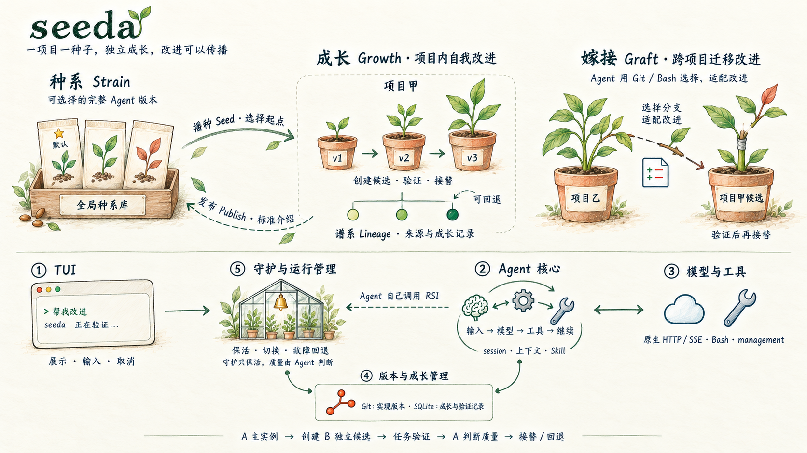
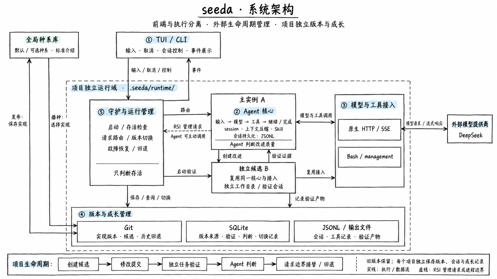

# seeda

**一项目一种子，独立成长，改进可以传播。**

seeda 是面向递归自我改进（RSI）的本地 coding CLI。它从最小 Agent 循环起步，让 Agent 在真实任务中修改自己的实现、创建独立候选、检查验证证据，再请求接替或回退。

使用 TypeScript 自行实现核心、模型接入与工具循环，不依赖 Agent 或模型 SDK。当前为早期版本，主要在 macOS 验证；Linux 由 CI 检查，Windows 尚未验证。



完整说明见 [seeda 项目介绍](docs/seeda项目介绍.md)。

## 快速开始

需要 **Node.js 24.14+、Git、npm**。目前从源码安装，尚未发布 npm 包。

```bash
git clone https://github.com/SJF-ECNU/seeda.git
cd seeda
npm ci
npm link
seeda --help
seeda --version
```

模型请求使用 DeepSeek 原生 Chat Completions / SSE。将凭据设在本地 shell 中；帮助和版本不需要凭据。

```bash
export DEEPSEEK_API_KEY='你的 API Key'
# 可选：使用你的账号支持的模型与端点
export DEEPSEEK_BASE_URL='https://api.deepseek.com'
export DEEPSEEK_MODEL='deepseek-flash'

cd /path/to/your-project
seeda seed       # 选择默认或其他种系，设置项目起点
seeda            # 自动启动或复用守护，进入 TUI
```

首次直接运行 `seeda` 也会选择种系。模型名称必须是提供商实际支持的 ID。配置示例见 [.env.example](.env.example)；程序不会自动读取 `.env`，请使用 shell 环境变量，或在源码入口使用 `node --env-file=.env --use-env-proxy --experimental-strip-types src/cli.ts`。

单次任务使用明确入口，控制命令不会被当作任务发给模型：

```bash
seeda run "检查项目，修复失败测试"
seeda -- "把这段文字当作任务"
seeda status
seeda stop
```

`/exit` 退出前端，守护继续运行；`seeda stop` 显式停服。启动时自动准备运行依赖，首次可能需要等待。`SEEDA_MANAGED=0 seeda` 使用直接模式。

## 核心概念

| 概念 | 含义 |
|---|---|
| 种系 Strain | 可命名、选择、运行和传播的Agent 执行实现版本 |
| 播种 Seed | 从全局库选择种系，为项目建立初始版本 |
| 成长 Growth | 同一项目内部修改实现、验证候选并迭代版本 |
| 谱系 Lineage | 记录版本来源和项目成长历史 |
| 发布 Publish | 将保存的实现版本与标准介绍登记到全局种系库 |
| 嫁接 Graft | Agent 用 Git / Bash 将其他种系的选定改进适配到当前候选 |

成长与嫁接是两种不同的改进来源，最终都通过候选验证与接替流程。嫁接由 Agent 完成代码适配，没有专用导出/导入工具，也不假定改进能够即插即用。

## 架构

CLI／TUI 和守护进程属于稳定安装层，始终从安装目录启动，不跟随项目版本切换。种系保存 Agent 核心、模型、工具、Skill 和 worker 执行入口；旧完整快照仍兼容，但其中的前端和守护不会被当前入口加载。



| 模块 | 职责 |
|---|---|
| TUI / CLI | 展示、输入、取消与会话控制 |
| Agent 核心 | 输入 → 模型 → 工具 → 继续/完成；session、上下文压缩与 Skill |
| 模型与工具 | 原生 HTTP/SSE 接入、Bash、明确的 management RSI 工具 |
| 版本与成长 | Git 保存实现；SQLite 保存来源、验证、判断与切换；JSONL 保存会话 |
| 守护与运行管理 | 启动、存活、路由、请求边界切换、故障恢复与回退 |

主实例 A 创建候选 B；B 使用独立目录和验证会话执行任务，A 根据证据判断是否接受，然后主动调用 RSI 接口请求接替。守护只负责存活，不评价回答或改进质量。旧版本保留供回退；保存的版本不会因安装源码修改而自动升级。图为概览，具体接口与方向以[运行指南](docs/版本守护与RSI运行指南.md)和代码为准。

seeda 提供自我改进的执行和生命周期机制，实际改进由任务驱动；没有默认定时自进化任务。会话历史由 session 管理；随版本的自身指令和通用记忆分别位于 `.agents/self/INSTRUCTIONS.md` 与 `.agents/self/MEMORY.md`，项目 `AGENTS.md` 与 Skills 独立加载。详见[自身指令与项目规则](docs/自身指令与项目规则.md)。项目知识可通过 Skill 使用。Bash 使用当前用户权限执行命令。候选的独立目录会进一步放进沙箱运行，见下节。

## 候选评估沙箱

候选版本不会在项目目录中直接运行；`seeda evaluate` 及其对应的 `management` 操作会为候选建立沙箱：

| 后端 | 适用 | 实现 |
|---|---|---|
| `process` | 轻量、纯 Node 内联逻辑 | macOS `sandbox-exec` 的 Seatbelt 策略；Linux `bubblewrap` 用户命名空间 |
| `container` | 需要 Bash、安装依赖或启动服务 | Docker：只读根文件系统、去除能力、限制进程数/内存/CPU，候选源码只读挂载于 `/candidate` |

选择规则：`evaluate(version, task, sandbox)` 中 `sandbox` 必须是 `process` 或 `container`；省略时默认为 `process`。**没有未沙箱回退**——后端不可用即评估失败，不会退回到直接执行。

**后端选择**：默认 `process` 在 macOS 下支持继承 Seatbelt 的 Bash、Node、TypeScript、测试和 Git 子进程，不要求 Docker；取消、超时及宿主退出时回收后台后代。需要独立 Linux 环境或依赖时显式选 `container`。macOS 的回收使用系统 Python 3 调用内核沙箱查询；该能力不可用时启动失败，不放宽隔离。详见 [[docs/evaluate沙箱]]。

## 会话与 TUI

Markdown 展示、流式输出、工具状态与详情；输入 `/` 预览命令，↑↓ 选择、Tab 补全、Enter 执行，`Ctrl+O` 展开工具详情，`Ctrl+C` 取消当前任务。

| 命令 | 用途 |
|---|---|
| `/new` | 新建会话，保留旧会话 |
| `/sessions` | 列出会话及完整 ID |
| `/resume ID` | 切换已有会话 |
| `/compact` | 主动摘要早期上下文，保留原始记录 |
| `/versions` | 查看保存的实现版本 |
| `/use ID` | 显式选择实现版本 |
| `/rollback` | 回退前一版本 |
| `/exit` | 退出前端 |

切换会话或版本前先结束或取消当前任务。托管模式支持这些控制操作，直接模式只运行核心循环。

## 种系选择与发布

```bash
seeda strains
seeda strains default coding-plus
seeda seed coding-plus
seeda publish coding-plus --intro intro.json
# 可显式指定已保存的项目版本
seeda publish coding-plus-v2 VERSION_ID --intro intro.json
```

发布介绍包含五个非空字符串：

```json
{
  "summary": "一句话介绍",
  "improvements": "具体改进",
  "scenarios": "适用场景",
  "limitations": "限制与依赖",
  "validation": "实际验证情况，未验证请明确说明"
}
```

项目状态在 `.seeda/runtime/`，全局库默认在 `~/.local/share/seeda/strains-library`。`SEEDA_LIBRARY` 可指定全局库，`SEEDA_HOME` 可覆盖运行根；覆盖根只能服务一个项目。发布实现不复制会话、运行数据库或凭据。重复播种拒绝覆盖已有项目。详见[种系选择与发布](docs/种系选择与发布.md)和[Agent 嫁接流程](docs/Agent嫁接流程.md)。

## 失败与重试

暂时性模型请求失败最多尝试3次，带退避；单次超时可重试，取消/鉴权错误不重试。已流出正文后不自动重放。Bash失败保留退出码和输出，不盲目重复有副作用的命令，也不会因清理异常退出整个会话。详见 [1.0.1 更新对比](docs/1.0.1更新对比.md)。

## 开发与文档

```bash
npm ci
npm link          # CLI 集成测试也使用 seeda 命令
npm run check
npm test
npm start
npm start -- run "任务文本"
```

测试使用本地模型与隔离目录，不需要真实模型凭据；真实提供商验证需另行配置。

- [CLI 命令与参数](docs/CLI命令与参数.md)
- [版本守护与 RSI 运行指南](docs/版本守护与RSI运行指南.md)
- [RSI 架构设计](docs/RSI架构设计.md)
- [Agent 核心实现与验证](docs/Agent核心实现与验证.md)
- [TUI 前端实现与验证](docs/TUI前端实现与验证.md)
- [开发规则](AGENTS.md) · [OpenSpec](openspec/) · [项目记忆](project-memory/首页.md)

设计与历史文档保留 Obsidian 双链，可将仓库根目录作为 Vault 打开。提议改进或报告问题可创建 [Issue](https://github.com/SJF-ECNU/seeda/issues)；代码变更使用 OpenSpec 规划，并提交与变化相称的验证。

## License

[MIT](LICENSE) © 2026 seeda contributors.
